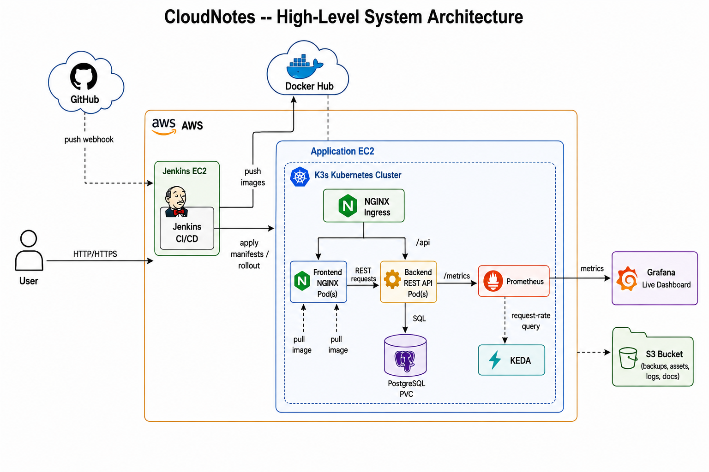
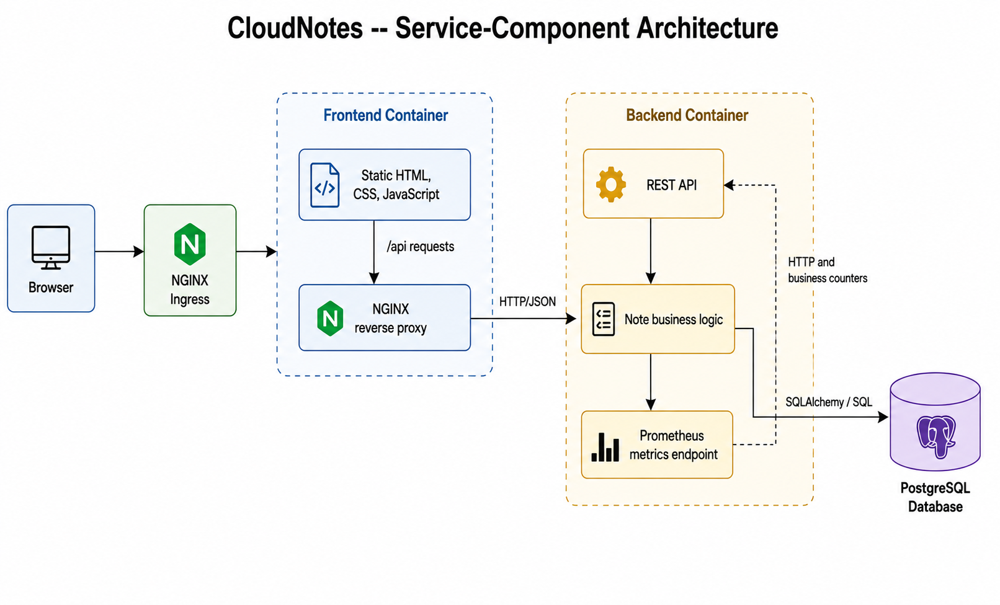
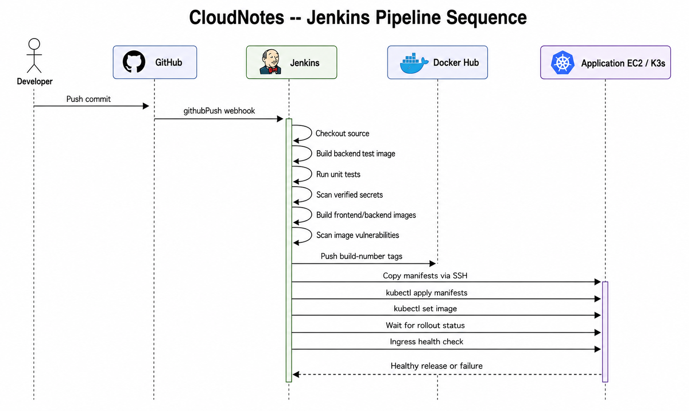
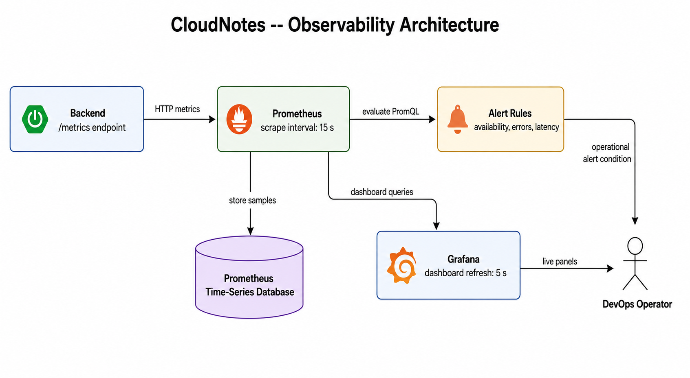

% CloudNotes Project Report
% INT378: Advancements in Cloud and DevOps
% Lovely Professional University
% Savinay Singh
% 14 October 2026

\newpage

# Contents

- Executive Summary
- 1. Introduction
- 2. Application and System Design
- 3. Runtime and Deployment Architecture
- 4. Infrastructure as Code
- 5. CI/CD and DevSecOps
- 6. Observability
- 7. Security, Reliability, and Risks
- 8. Verification and Acceptance Plan
- 9. INT378 Course Outcome Alignment
- 10. Conclusion and Future Work
- References
- Appendix A. Repository guide

\newpage

# Executive Summary

CloudNotes is a small full-stack note-taking application used to demonstrate an end-to-end DevOps workflow. Users can create, list, search, update, and delete notes through a browser interface. The application is composed of a static Nginx frontend, a Flask REST API, and PostgreSQL persistence. Docker packages the application services, Docker Compose provides a local multi-service environment, Kubernetes manifests describe a cluster deployment, and Terraform provisions AWS infrastructure. Jenkins automates validation, image publication, and deployment. Prometheus collects backend metrics and Grafana presents a dashboard in the Compose environment.

The project emphasizes reproducible delivery and operational visibility. Its scope is an academic demonstration: the AWS topology uses a single public subnet and a single K3s application host; the API has no authentication; and example credentials in configuration must be replaced. Repository configuration documents intended behavior, while a live AWS endpoint is not guaranteed to remain available because public IPs and infrastructure state can change.

# 1. Introduction

Manual setup makes application environments hard to reproduce and releases difficult to audit. CloudNotes applies infrastructure as code, containers, CI/CD, orchestration, and metrics to a practical application so each step from source change to running service can be examined. The note-taking domain is intentionally simple; the focus is on how services are packaged, deployed, monitored, and updated.

## 1.1 Objectives

- Implement note creation, listing, search, update, and deletion with persistent storage.
- Package the frontend and backend independently and run the complete local stack with Compose.
- Describe a Kubernetes deployment with health checks, persistent database storage, ingress, and horizontal scaling.
- Provision AWS network, EC2, and S3 resources using Terraform.
- Automate backend tests, security scans, image publication, and Kubernetes rollout through Jenkins.
- Collect HTTP and business metrics with Prometheus and visualize them with Grafana.

## 1.2 Scope and limitations

The project is not a production-ready notes service. There is no user authentication, authorization, multi-tenant note ownership, TLS configuration, multi-AZ cluster, managed database, or tested disaster-recovery process. The Terraform security groups and example deployment values require review before public use. Resource claims below distinguish repository configuration from runtime evidence.

# 2. Application and System Design



The browser downloads static assets from Nginx. Nginx proxies `/api` requests to Flask. Flask validates requests, reads or writes the Note model using SQLAlchemy, and stores data in PostgreSQL. The API also exposes `/api/health` for health checks and `/metrics` for Prometheus. The frontend does not connect to the database directly.

## 2.1 Technology stack

| Area | Technology | Responsibility |
| --- | --- | --- |
| Frontend | HTML, CSS, JavaScript, Nginx | Note UI and browser-facing reverse proxy |
| API | Flask, Flask-SQLAlchemy, Gunicorn | REST operations, persistence logic, health, and metrics |
| Database | PostgreSQL 15 | Persistent note records |
| Local orchestration | Docker Compose | Starts app, database, Prometheus, and Grafana |
| Cluster orchestration | Kubernetes, K3s, KEDA, Nginx Ingress | Services, rollout, ingress, recovery, and traffic-based replica scaling |
| Infrastructure | Terraform and AWS | VPC, public subnet, security groups, EC2, S3, and billing alarm |
| Delivery | Jenkins, GitHub, Docker Hub | CI checks, image publishing, and cluster deployment |
| Monitoring | Prometheus, Grafana | Metrics, alert rules, and visual dashboard |

## 2.2 Data model

The `note` table contains `id` (integer primary key), `title` (required string up to 100 characters), `body` (required text), and `created_at` (UTC timestamp). The API returns JSON and timestamps in ISO format. PostgreSQL is used in Compose and Kubernetes; the application has a SQLite fallback when `DATABASE_URL` is unset.

## 2.3 REST API

| Method | Path | Behavior | Success response |
| --- | --- | --- | --- |
| GET | `/api/health` | Health probe | `200`, `{"status":"ok"}` |
| GET | `/api/notes` | List notes | `200`, JSON array |
| GET | `/api/notes?search=<text>` | Search title and body | `200`, matching JSON array |
| POST | `/api/notes` | Create with JSON `title` and `body` | `201`, id and message |
| PUT | `/api/notes/<id>` | Update supplied fields | `200`, id and message |
| DELETE | `/api/notes/<id>` | Delete a note | `200`, message |
| GET | `/metrics` | Prometheus exposition | `200`, Prometheus text format |

Missing title/body on create returns `400`; requests for unknown note IDs return `404`. The API is unauthenticated and should not be exposed to untrusted users without an identity and authorization layer.

# 3. Runtime and Deployment Architecture



## 3.1 Docker Compose

`docker/docker-compose.yml` defines `db`, `backend`, `frontend`, `prometheus`, and `grafana` services on a private bridge network. PostgreSQL data is stored in the named `pgdata` volume. The host ports are 80 (frontend), 5000 (backend), 9091 (Prometheus), and 3001 (Grafana). Compose waits for the database health check before starting the backend. The `.env.example` file is a template; a local `.env` must contain non-placeholder values and must remain untracked.

## 3.2 Kubernetes

The manifests create a `cloudnotes` namespace, backend and frontend Deployments and Services, a PostgreSQL Deployment and Service, a PersistentVolumeClaim, a Secret, an Ingress, Prometheus, and KEDA ScaledObjects. The backend Deployment starts with two replicas and uses liveness/readiness probes against `/api/health`. The frontend starts with two replicas. Ingress routes `/api` to the backend and `/` to the frontend for host `cloudnotes.local`.

KEDA polls Prometheus every 15 seconds and scales the backend between 2 and 5 replicas and the frontend between 2 and 4 based on the aggregate Flask HTTP request-rate metric. A 60-second cooldown is configured. This is horizontal pod scaling; the CPU and memory requests/limits are scheduling and resource-bound settings, not vertical autoscaling. KEDA and an ingress controller must be installed in the cluster before their custom resources and ingress rules can function.

`kubernetes/monitoring.yaml` deploys Prometheus and configures the backend scrape and alert rules. Grafana and its provisioned dashboard are present in the local Compose setup; the Kubernetes manifests do not deploy Grafana.

## 3.3 AWS infrastructure

Terraform modules create a VPC, one public subnet in `ap-south-1a`, an internet gateway and route table, security groups, two EC2 instances, and an S3 bucket. The Jenkins EC2 instance runs Jenkins in Docker. The application EC2 instance bootstraps K3s, KEDA, and Nginx Ingress. Terraform outputs expose the current public IPs and bucket name. Because the subnet and app cluster are single-node, this topology has no multi-AZ or node-level high availability. Review `terraform/modules/vpc/main.tf` before applying: several ingress rules accept public traffic for demonstration purposes.

## 3.4 Deployment models

| Model | Intended use | Main entry point |
| --- | --- | --- |
| Docker Compose | Local development and monitoring demonstration | `docker compose -f docker/docker-compose.yml up --build -d` |
| Minikube / Kubernetes | Cluster resource and scaling demonstration | `kubectl apply -f kubernetes/` after installing ingress and KEDA |
| AWS | Cloud infrastructure and remote Jenkins/K3s demonstration | Terraform; optional Windows wrapper `start_mumbai.bat` |

# 4. Infrastructure as Code

Terraform configuration is under `terraform/`. `main.tf` composes the VPC, Jenkins EC2, application EC2, and S3 modules; `outputs.tf` exposes addresses. `billing_alarm.tf` configures cost-alert resources. The SSH public key, AWS credentials, state, and any environment-specific values must be supplied outside version control. The checked-in SSH key variable default is a placeholder and is not usable for deployment.

Typical review sequence:

```powershell
terraform -chdir=terraform init
terraform -chdir=terraform plan
terraform -chdir=terraform apply
terraform -chdir=terraform output
```

Destroy resources when the environment is no longer needed, after reviewing what Terraform will remove:

```powershell
terraform -chdir=terraform destroy
```

Actual charges may continue for resources outside the Terraform state or resources retained by AWS. Confirm cleanup in the account rather than assuming the destroy command guarantees a zero bill.

# 5. CI/CD and DevSecOps



The root `Jenkinsfile` is pipeline-as-code. A GitHub push trigger starts checkout, builds a backend test image and runs pytest, scans the workspace for verified secrets with TruffleHog, builds versioned backend/frontend images, scans the backend image with Trivy, pushes version and `latest` tags to Docker Hub, then uses SSH and `kubectl` to apply manifests and deploy the build-number-tagged images. The pipeline waits for Deployment rollouts and checks `/api/health` through ingress. Concurrent builds are disabled.

The current Trivy invocation uses `--exit-code 0`, so findings are reported but do not block the build. Jenkins credentials are referenced by ID (`dockerhub-credentials`, `app-server-ssh-key`) and must be configured in Jenkins. The target app host is supplied through `APP_SERVER_IP` in the pipeline configuration and must match the current Terraform output. Jenkins connectivity, webhook setup, Docker Hub access, and SSH access are prerequisites; checked-in pipeline code alone is not evidence that a deployment succeeded.

# 6. Observability



The Flask exporter supplies HTTP request metrics and custom counters `notes_created_total`, `notes_updated_total`, and `notes_deleted_total`. Prometheus scrapes the backend `/metrics` endpoint every 15 seconds. Local Prometheus configuration also loads alert rules for backend availability, high 5xx error rate, high p95 request latency, and an hour without note creation after prior activity. Grafana provisions a Prometheus data source and a dashboard with backend status, note counters, error rate, request rate, p95 latency, and backend memory panels.

Prometheus metrics support KEDA's request-rate scaling trigger. Monitoring alerts in this configuration define conditions; notification delivery requires a separately configured Alertmanager receiver. No such receiver is configured in the repository.

# 7. Security, Reliability, and Risks

| Area | Current implementation | Remaining risk / improvement |
| --- | --- | --- |
| Secrets | Jenkins credential bindings, `.env.example`, Kubernetes Secret template, TruffleHog scan | Replace placeholders; rotate any exposed credentials; use managed secret storage; Kubernetes Secret values are not encrypted by the YAML format alone |
| Image security | Trivy scans backend image for HIGH/CRITICAL CVEs | Current scan is non-blocking; make policy explicit and scan both images |
| Network | AWS security groups and Kubernetes Services | Restrict public SSH, Jenkins, API, and monitoring exposure; add TLS |
| Application access | Frontend escapes rendered note content; API validates create fields | No authentication/authorization or rate limiting; add identity and per-user note ownership |
| Runtime health | Backend liveness/readiness probes and Jenkins rollout checks | Health endpoint does not verify database connectivity; add a readiness dependency check |
| Data | PostgreSQL PVC and Compose named volume | No automated backup/restore or migration framework; single database replica |
| Availability | Kubernetes restarts unhealthy pods and maintains multiple app replicas | AWS app cluster is a single node in one subnet; node failure can interrupt service |
| Cost | Terraform billing alarm and destroy workflow | Review alarm configuration and retained resources; monitor actual account charges |

# 8. Verification and Acceptance Plan

The repository includes backend tests at `app/backend/tests/test_app.py` for health, create validation, listing, search, update, deletion, and missing IDs. End-to-end browser automation is under `tests/e2e/`. A complete demonstration should capture outputs from the actual environment rather than infer success from configuration files.

| Area | Demonstration | Evidence |
| --- | --- | --- |
| Application | Create, list, search, edit, and delete a note | Browser flow and persisted API response |
| Containers | Build and start Compose stack | Successful image builds and healthy services |
| Kubernetes | Apply manifests; inspect pods, services, ingress, PVC | Ready resources and successful health check |
| CI/CD | Push a harmless change | Jenkins stage results, published build tags, successful rollout |
| Scaling | Generate sustained API traffic | Prometheus request-rate query and KEDA/deployment replica changes |
| Monitoring | Perform note operations | Prometheus targets/alerts and Grafana panel updates |
| Infrastructure | Terraform plan/apply in authorized account | Plan and outputs; AWS resource state |
| Cleanup | Destroy demonstration infrastructure | Terraform output and AWS account resource review |

Configuration in the repository describes the intended setup; runtime acceptance evidence must be collected during the actual run. Do not claim an AWS endpoint, pipeline build, or autoscaling event succeeded without current evidence.

# 9. INT378 Course Outcomes and Practical Alignment

The following mapping uses the official outcomes and practical topics in the INT378 course module. It separates what the repository configures from what remains outside the project or needs live demonstration evidence.

| INT378 outcome | Relevant CloudNotes work | Coverage and limits |
| --- | --- | --- |
| CO1: Recall cloud computing concepts/models and security | AWS VPC, EC2, S3, Terraform provisioning, container and Kubernetes architecture; security discussion in this report | Demonstrates selected AWS and cloud-native concepts. IAM users, groups, roles, MFA, and RBAC are not configured in the repository. |
| CO2: Analyze methods/tools for scalability in cloud solutions | Kubernetes Deployments and KEDA Prometheus scaler using API request rate | Configuration defines horizontal replica bounds. A sustained-load experiment and captured scaling evidence are still required for a demonstrated result. |
| CO3: Explain network security and authentication in cloud environments | VPC/security groups, Kubernetes Services/Ingress, and discussion of authentication gaps | Network controls exist but some AWS ingress is public. The app has no authentication or authorization, and no IAM/MFA implementation is included. |
| CO4: Evaluate cost optimization and cloud-native development | Containerized services, API separation, Terraform, billing alarm, and destroy workflow | Cloud-native deployment and basic cost awareness are present. Cost Explorer analysis, AWS Budgets, and measured optimization recommendations are not included. |
| CO5: Apply security practices in development and deployment | TruffleHog secret scan, Trivy image scan, Jenkins credential bindings, Kubernetes Secret template, health probes | Security checks are configured; Trivy is non-blocking, sample Kubernetes credentials are placeholders, and a managed secrets solution is absent. |
| CO6: Explore emerging cloud trends and governance | K3s/Kubernetes, KEDA metric-based scaling, Prometheus/Grafana observability | Demonstrates selected cloud-native practices. Formal compliance auditing, governance policy enforcement, serverless deployment, and CloudFormation comparison are outside scope. |

The project covers several practical themes through Docker/Docker Hub, Terraform, Jenkins automation, DevSecOps scans, and Prometheus/Grafana. It does not implement IAM/MFA, CloudFormation, Node Exporter infrastructure monitoring, Lambda/serverless, or Cost Explorer/AWS Budgets analysis. Successful cloud provisioning, pipeline execution, and scaling should be supported by evidence from a current run.

# 10. Conclusion and Future Work

CloudNotes combines a working CRUD application with container packaging, declarative infrastructure, Kubernetes orchestration, Jenkins delivery automation, security scanning, and metrics-based operations. Its strongest educational value is the connected workflow: source changes become tested and scanned images, those images are deployed as Kubernetes workloads, and application behavior can be observed through Prometheus and Grafana.

Recommended future work, aligned with INT378, includes IAM roles and MFA, application authentication and authorization, TLS and private network boundaries, CloudFormation comparison, managed secrets, Node Exporter and infrastructure dashboards, AWS Budgets/Cost Explorer analysis, a serverless extension, governance/compliance checks, database backups, a multi-node/multi-AZ cluster, blocking vulnerability policies, and repeatable load/scaling evidence.

# References

Technical references: [Docker](https://docs.docker.com/); [Kubernetes](https://kubernetes.io/docs/); [Terraform AWS Provider](https://registry.terraform.io/providers/hashicorp/aws/latest/docs); [Jenkins](https://www.jenkins.io/doc/); [Prometheus](https://prometheus.io/docs/); [Grafana](https://grafana.com/docs/); [KEDA](https://keda.sh/docs/).

\newpage

# Appendix A. Repository guide

| Path | Contents |
| --- | --- |
| `app/backend/` | Flask API, SQLAlchemy model, requirements, Dockerfile, unit tests |
| `app/frontend/` | HTML, CSS, JavaScript, Nginx configuration, Dockerfile |
| `docker/` | Compose files, environment template, recovery script |
| `kubernetes/` | Namespace, app/database/monitoring resources, ingress, KEDA scaling |
| `terraform/` | AWS root module, VPC/EC2/S3 modules, outputs, billing alarm |
| `jenkins/`, `Jenkinsfile` | Jenkins image/configuration and pipeline |
| `monitoring/` | Local Prometheus config/alerts and Grafana provisioning/dashboard |
| `diagrams/` | Architecture, deployment, scaling, and sequence diagrams |
| `tests/e2e/` | Puppeteer end-to-end browser automation |
