% COURSE PROJECT REPORT
% CLOUDNOTES: A CONTAINERIZED CLOUD APPLICATION WITH DEVOPS AND DEVSECOPS PIPELINE
% Course Code: INT378 (Advancements in Cloud and DevOps)
% Course Instructor: Mr. Ajay Kumar Badhan
% Submitted by: Savinay Singh (Registration No.: 12308126 | Section: K3O2312 | Roll No.: 10)
% School of Computer Science and Engineering
% LOVELY PROFESSIONAL UNIVERSITY, PUNJAB
% Academic Session: 2026-2027

\newpage

# Contents

- **Executive Summary**
- **1. Introduction and Project Objectives** (Problem Statement, Objectives, Scope)
- **2. Application Architecture and Design** (Three-Tier Design, Technology Stack, Data Model, REST API)
- **3. Containerization and Orchestration** (Docker, Compose, K3s, Ingress, KEDA)
- **4. Infrastructure as Code with Terraform** (Modules, VPC, Cloud-Init, Billing Alarm)
- **5. CI/CD and DevSecOps Pipeline** (Jenkins, Testing, Secret Scanning, Vulnerability Scanning)
- **6. Monitoring, Dashboards, and Alerting** (Prometheus, Alert Rules, Grafana, KEDA, CloudWatch)
- **7. Security and Risk Assessment** (Security Layers, Risk Matrix)
- **8. Live AWS Deployment and Verification** (Screenshots, API Tests, Teardown)
- **9. INT378 Course Outcomes Alignment** (CO1–CO6 Mapping)
- **10. Conclusion and Future Work**
- **References**
- **Appendix A. Repository Structure**

\newpage

# Executive Summary

**CloudNotes** is my course project for **INT378: Advancements in Cloud and DevOps** at Lovely Professional University. I developed and deployed a web application for creating, reading, updating, and deleting notes, using cloud infrastructure and automated DevOps practices.

The application separates the frontend, backend, and database into three independent containers. The frontend is a single-page HTML/CSS/JavaScript interface served by Nginx. The backend is a Python Flask REST API that stores data in PostgreSQL. All three components run as Docker containers, both locally (using Docker Compose) and on AWS (using Kubernetes via K3s).

I automated the cloud infrastructure using Terraform, which provisions an AWS VPC, EC2 instances, security groups, and S3 storage in the Mumbai region. I configured a Jenkins CI/CD pipeline that runs tests, scans for secrets and vulnerabilities, builds Docker images, and deploys them to the Kubernetes cluster over SSH.

For monitoring, I configured the Flask backend to expose metrics such as request count and response time. In the AWS Kubernetes cluster, an in-cluster Prometheus instance scrapes these metrics every 15 seconds to drive KEDA event-driven pod autoscaling. In the local Docker Compose environment, Prometheus collects telemetry and a provisioned Grafana dashboard visualizes service health, throughput, error rates, and latency.

This report documents my design decisions, implementation details, deployment evidence, and how the project maps to the INT378 course outcomes (CO1–CO6).


# 1. Introduction and Project Objectives

## 1.1 Problem Statement

Modern software deployment has several well-known challenges:
- **Configuration drift**: When servers are set up manually, environments gradually become different from each other. This leads to the common problem where software works on one machine but fails on another.
- **Manual deployments**: Deployments that depend on human steps are error-prone and hard to reproduce.
- **Security as an afterthought**: Without automated scanning, leaked secrets and vulnerable dependencies may go unnoticed until they cause problems.
- **Lack of visibility**: Without metrics and health checks, it is difficult to detect problems or scale services before users are affected.

I built CloudNotes to address these challenges. The application itself—a simple note-taking tool—is deliberately small so that the main focus of the project is on the cloud infrastructure, automation, and monitoring around it.

## 1.2 Project Objectives

The project achieves the following objectives:
1. **Containerized application**: Build a note-taking service with create, read, update, and delete (CRUD) operations, input validation, and PostgreSQL storage, packaged as Docker containers.
2. **Automated cloud setup**: Write modular Terraform code to provision AWS networking, compute, and storage resources in a repeatable and version-controlled way.
3. **Kubernetes orchestration**: Deploy the application on a K3s cluster with resource limits, health probes, Ingress routing, and rolling updates.
4. **Automated CI/CD pipeline**: Set up a Jenkins pipeline that runs 9 unit tests in Pytest, scans for secrets (TruffleHog) and vulnerabilities (Trivy), builds images, pushes them to Docker Hub, and deploys to the cluster.
5. **Monitoring and autoscaling**: Collect application metrics with Prometheus, visualize them in Grafana, and use KEDA to scale pods based on HTTP traffic.
6. **Course alignment**: Map the project work to the INT378 Course Outcomes (CO1–CO6).

## 1.3 Scope and Boundaries

This section explains what the project includes and what is outside its scope:
- **Included**: VPC networking, EC2 provisioning, K3s Kubernetes cluster, Nginx Ingress, PostgreSQL database, Jenkins CI/CD pipeline, TruffleHog secret scanning, Trivy image scanning, Prometheus metrics, Grafana dashboards, and KEDA autoscaling.
- **Not included in this demonstration**: The AWS deployment uses a single public subnet in one Availability Zone. Features such as user authentication (OAuth2/SSO), TLS certificates (Let's Encrypt), multi-region replication, and managed database backups are identified as future work.


# 2. Application Architecture and Design

## 2.1 Three-Tier Architecture

CloudNotes separates the frontend, backend, and database into three independent tiers. Each tier runs in its own container and communicates over the network. This separation makes it possible to scale, update, or replace each part independently.


1. **Frontend**: A single-page web interface built with HTML5, CSS3, and JavaScript, served by an Nginx web server acting as a reverse proxy.
2. **Backend API**: A Python 3.11 Flask REST API handling endpoints, data validation, SQLAlchemy ORM operations, and Prometheus metrics.
3. **Database**: A PostgreSQL 15 database storing application state with persistent storage.

\newpage

## 2.2 Technology Stack

| Layer | Technology | Version | Purpose |
| --- | --- | --- | --- |
| Web Server | Nginx | 1.25 Alpine | Serves frontend files and proxies API requests to backend |
| Frontend UI | HTML5, CSS3, JS | ES6+ | Responsive single-page interface with dynamic toast notifications |
| Backend API | Python, Flask | 3.11 / 3.0 | REST API endpoints, JSON request processing, business logic |
| WSGI Server | Gunicorn | 21.2 | Multi-worker production WSGI HTTP server |
| ORM Layer | Flask-SQLAlchemy | 3.1.1 | Object-relational mapping and database connection management |
| Database | PostgreSQL | 15 Alpine | Relational storage for notes with ACID transaction support |
| Containers | Docker, Compose | 24.0+ / v2 | Packages each service into isolated local containers |
| Orchestration | K3s (Kubernetes) | v1.36+ | Container management in production with self-healing deployments |
| Ingress | Ingress-Nginx | Helm 4.10+ | Routes HTTP traffic by hostname to frontend and backend services |
| Autoscaling | KEDA | 2.14+ | Dynamic pod autoscaling driven by Prometheus HTTP metrics |
| Cloud Host | AWS | ap-south-1 | EC2 compute, custom VPC networking, S3 bucket storage |
| IaC Engine | Terraform | 1.8+ | Declarative cloud infrastructure provisioning and state tracking |
| CI/CD Server | Jenkins | 2.440+ LTS | Automated build, test, scan, and deployment pipeline |
| Secret Scan | TruffleHog | 3.63+ | Scans the checked-out repository during CI for verified leaked credentials and API tokens |
| Security Scan | Trivy | 0.50+ | Analyzes container images for known OS and library CVEs |
| Monitoring | Prometheus, Grafana | 2.45 / 10.0 | Time-series metric collection, alert rules, and visual dashboards |

\newpage

## 2.3 Data Model

The application stores notes using a single database table. The `Note` model is defined with SQLAlchemy ORM:

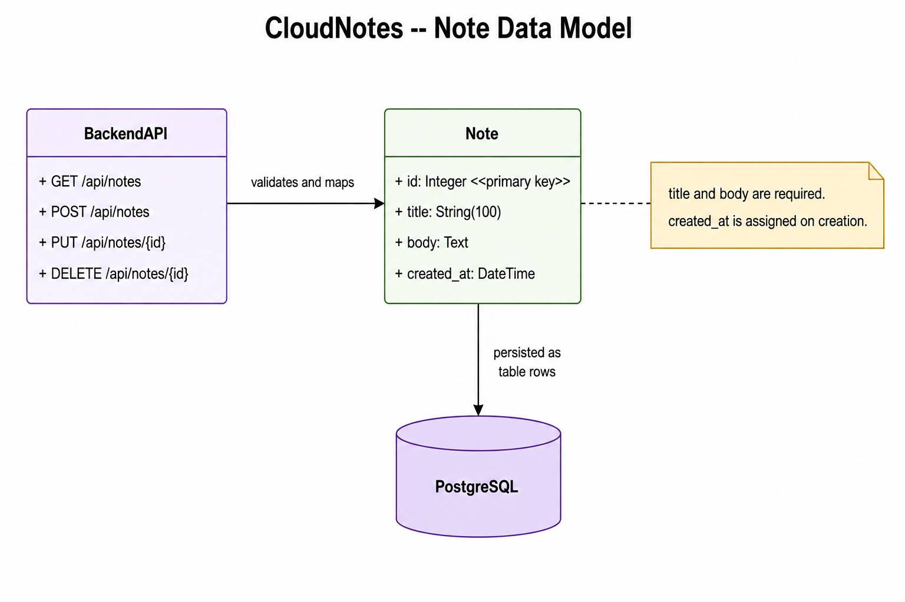

```python
class Note(db.Model):
    id         = db.Column(db.Integer, primary_key=True)
    title      = db.Column(db.String(100), nullable=False)
    body       = db.Column(db.Text, nullable=False)
    created_at = db.Column(
        db.DateTime,
        default=lambda: datetime.now(timezone.utc)
    )
```

Key details about the schema:
- `id` is an auto-incrementing integer primary key.
- `title` is defined as `db.String(100)` and is required (`nullable=False`).
- `body` is stored as `db.Text` and is required (`nullable=False`).
- `created_at` records the UTC creation timestamp, formatted as ISO 8601 for frontend display.
- SQLAlchemy uses the default table name `note` (lowercase class name).

\newpage

## 2.4 REST API

The Flask backend provides the following API endpoints:

| Method | Endpoint | Request Body | Status | Description |
| --- | --- | --- | --- | --- |
| GET | `/api/health` | None | 200 OK | Service liveness probe returning `{"status":"ok"}` |
| GET | `/api/notes` | None | 200 OK | Returns all notes from the database as a JSON list |
| GET | `/api/notes?search=q` | Query string | 200 OK | Case-insensitive keyword filter across title and body |
| POST | `/api/notes` | `{"title", "body"}` | 201 Created | Creates a new note (requires title and body) |
| PUT | `/api/notes/<id>` | `{"title"} or {"body"}` | 200 OK | Updates note title or body; returns 404 if not found |
| DELETE | `/api/notes/<id>` | None | 200 OK | Deletes note by ID; returns 404 if not found |
| GET | `/metrics` | None | 200 OK | Prometheus metrics for scraping |

**Request handling and validation**:
- In `POST /api/notes`, the backend checks for JSON data and verifies that both `'title'` and `'body'` keys are present. If either field is missing, it returns HTTP 400 (`{"error": "Missing title or body"}`).
- In `PUT /api/notes/<id>`, the backend checks for request data and updates `'title'` and/or `'body'` if provided. If the note ID does not exist, Flask-SQLAlchemy returns HTTP 404.
- In this implementation, `/api/health` serves as a simple service liveness probe that returns `{"status":"ok"}`. It confirms the Flask WSGI process is running; it does not query PostgreSQL directly.
- More restrictive validation rules—such as strict maximum body lengths, whitespace rejection, and a deep database probe in `/api/health`—represent recommended future improvements.

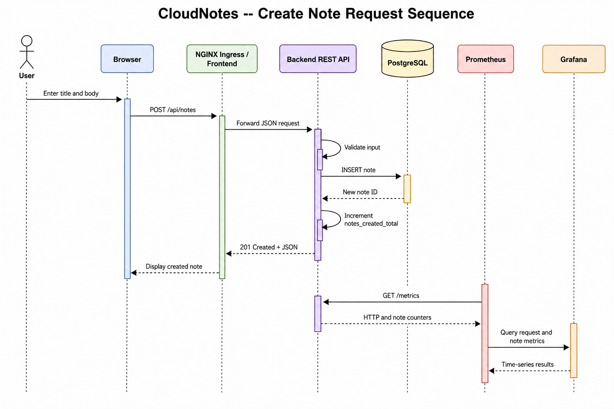


# 3. Containerization and Orchestration

## 3.1 Docker Images

Each component is packaged as a Docker image:
- **Backend** (`app/backend/Dockerfile`): Built on `python:3.11-slim`. Dependencies are installed with `--no-cache-dir` to keep the image small. Gunicorn serves the Flask application.
- **Frontend** (`app/frontend/Dockerfile`): Built on `nginx:1.25-alpine` (under 25 MB). Static files are copied into Nginx's default serving directory. A custom Nginx configuration proxies `/api/` requests to the backend.

## 3.2 Local Development with Docker Compose

For local development and testing, `docker/docker-compose.yml` runs five services on an internal bridge network (`cloudnotes-network`):


1. `db`: PostgreSQL 15 Alpine with a health check (`pg_isready`). Data is stored in a named volume (`pgdata`).
2. `backend`: The Flask API. It waits for the database to be healthy before starting. Runs on port 5000.
3. `frontend`: Nginx serving the web interface on port 80. Proxies API requests to the backend.
4. `prometheus`: Scrapes backend metrics every 15 seconds. Accessible on port 9091.
5. `grafana`: Displays dashboards on port 3001 with Prometheus as the data source.


## 3.3 Kubernetes Deployment on K3s

In production, the application runs on K3s, a lightweight Kubernetes distribution. All resources are deployed in a dedicated `cloudnotes` namespace.

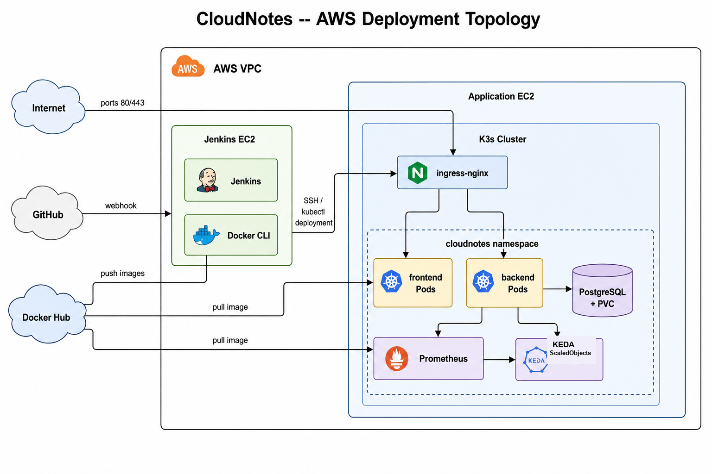

- **`namespace.yaml`**: Creates the `cloudnotes` namespace.
- **`postgres-secret.yaml` and `postgres-pvc.yaml`**: Store database credentials as a Kubernetes Secret and allocate 1 GiB of persistent storage.
- **`postgres-deployment.yaml`**: Runs a single PostgreSQL instance with a ClusterIP Service.
- **`backend-deployment.yaml`**: Runs 2 replicas of the backend. Each pod has resource requests (100m CPU, 128Mi RAM) and limits (300m CPU, 256Mi RAM). Liveness and readiness probes check `/api/health`.
- **`frontend-deployment.yaml`**: Runs 2 replicas of the Nginx frontend.
- **`ingress.yaml`**: Routes traffic for `cloudnotes.local` — requests to `/api` go to the backend, and all other requests go to the frontend.
- **`hpa.yaml`**: Defines KEDA `ScaledObject` resources for metric-driven autoscaling (named `hpa.yaml` because KEDA manages the underlying Kubernetes `HorizontalPodAutoscaler` behind the scenes).

## 3.4 Ingress Routing

The cluster uses the Ingress-Nginx controller, deployed via Helm (K3s's built-in Traefik is disabled). The Ingress resource routes requests based on the HTTP `Host` header:
```yaml
apiVersion: networking.k8s.io/v1
kind: Ingress
metadata:
  name: cloudnotes-ingress
  namespace: cloudnotes
  annotations:
    kubernetes.io/ingress.class: nginx
spec:
  rules:
  - host: cloudnotes.local
    http:
      paths:
      - path: /api
        pathType: Prefix
        backend:
          service:
            name: backend
            port: { number: 5000 }
      - path: /
        pathType: Prefix
        backend:
          service:
            name: frontend
            port: { number: 80 }
```
Because the Ingress matches on the `Host` header, requests sent directly to the server IP without that header will return HTTP 404. During testing, I added a hosts file entry mapping `cloudnotes.local` to the EC2 public IP. The manifest uses the common `kubernetes.io/ingress.class: nginx` annotation; migrating to standard `spec.ingressClassName` is planned in future work.

## 3.5 Autoscaling with KEDA

Kubernetes HPA commonly uses CPU and memory metrics, but it can also use custom or external metrics when the appropriate APIs are configured. KEDA simplifies event-driven scaling by connecting Kubernetes workloads to external metric sources such as Prometheus.

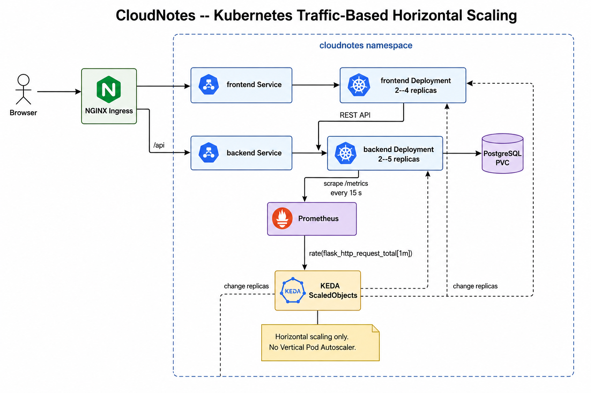

I configured two KEDA ScaledObjects in `kubernetes/hpa.yaml` (the KEDA operator controller runs in its dedicated `keda` namespace via Helm, while its `ScaledObject` resources manage deployments in the `cloudnotes` namespace):

**Backend scaler**: Scales the backend between 2 and 5 replicas. KEDA polls Prometheus every 15 seconds using the query `sum(rate(flask_http_request_total[1m]))`. When the aggregate request rate exceeds 5 requests per second, KEDA adds more pods. When traffic subsides, it scales back down to 2 replicas after a cooldown and stabilization period.

**Frontend scaler**: Scales the frontend between 2 and 4 replicas using the same Prometheus query (`sum(rate(flask_http_request_total[1m]))`). In this architecture, backend API request traffic serves as a proxy metric for user demand because static Nginx frontend traffic is not instrumented with custom metrics directly. Its threshold is 10 requests per second.

This allows the application to automatically adjust running pods according to the configured metric threshold, scaling out during traffic bursts and scaling in during idle periods.


# 4. Infrastructure as Code with Terraform

## 4.1 Modular Design

All cloud infrastructure is defined using Terraform. The code is organized into reusable modules under `terraform/`:

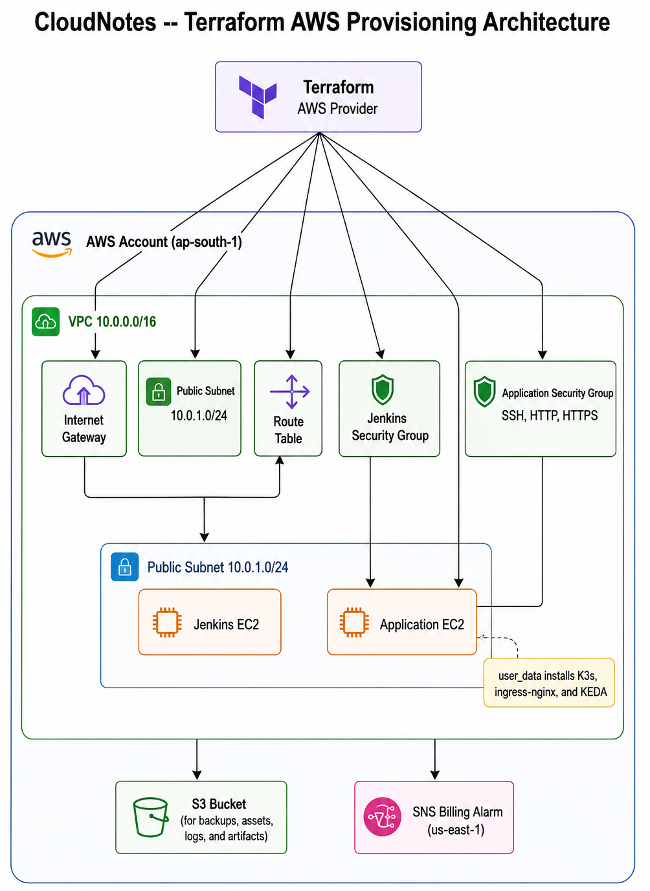

- **`modules/vpc`**: Creates the VPC, Internet Gateway, public subnet, route table, and security groups.
- **`modules/ec2`**: Reusable module for EC2 instances. Handles AMI selection (Ubuntu 22.04 LTS), instance type (`t3.small` by default), key pair, and cloud-init bootstrapping.
- **`modules/s3`**: Provisions an S3 bucket (`cloudnotes-frontend-dev`) intended for static assets and general storage (backups, logs, and artifacts). Note: public access block is currently disabled for prototyping. In production, this should be enabled with least-privilege IAM policies.
- **`billing_alarm.tf`**: Sets up a CloudWatch billing alarm that sends notifications when AWS charges reach a configured threshold.

## 4.2 Network Architecture

The network is set up in the Mumbai (`ap-south-1`) region:
- **VPC**: `10.0.0.0/16` address space.
- **Public Subnet**: `10.0.1.0/24` in Availability Zone `ap-south-1a`.
- **Internet Gateway and Route Table**: Route outbound traffic through the Internet Gateway.
- **Security Groups**:
  - `jenkins_sg`: Allows SSH (port 22) and Jenkins UI (port 8080) only from the administrator's IP address (`admin_cidr`).
  - `app_sg`: Allows HTTP (port 80) and HTTPS (port 443) from the public internet. Restricts Prometheus (9091) and Grafana (3001) to `admin_cidr`. Allows SSH from `admin_cidr` and from the Jenkins security group, so the Jenkins pipeline can deploy over SSH.

## 4.3 Automated Server Setup (Cloud-Init)

Both EC2 instances are configured automatically at launch using bash scripts passed through Terraform's `user_data`:
- **Jenkins server**: Installs Docker and Git, clones the repository, runs Jenkins Configuration as Code (`jenkins.yaml`), generates an SSH deploy key, and starts Jenkins in a Docker container.
- **Application server**: Installs K3s with Traefik disabled, configures kubeconfig, installs Helm 3, and deploys KEDA and Ingress-Nginx from their official Helm charts.

## 4.4 Billing Alarm

Terraform creates a CloudWatch metric alarm in `terraform/billing_alarm.tf`:
- Monitors the `EstimatedCharges` metric in the `AWS/Billing` namespace (via the `us-east-1` provider, which is where AWS reports billing metrics).
- The default threshold is **$1 USD** (configurable via the `billing_alarm_threshold` variable). The alarm evaluates the maximum charge over 6-hour periods.
- When the threshold is reached, it sends a notification to an SNS topic. An email subscription is created only if the `billing_alarm_email` variable is set, and requires email confirmation.
- **Important**: This alarm only sends a notification. It does not automatically stop or terminate any AWS resources. To clean up resources, I use `terraform destroy`.


# 5. CI/CD and DevSecOps Pipeline

## 5.1 Jenkins Configuration

The CI/CD pipeline is powered by Jenkins, configured using **Jenkins Configuration as Code (JCasC)** via `jenkins/jenkins.yaml`. This means the entire Jenkins setup—plugins, security settings, credentials, and job definitions—is stored in version control and can be reproduced on a fresh server.


## 5.2 Pipeline Stages

The pipeline is defined in the `Jenkinsfile` at the repository root. It is triggered automatically via GitHub webhooks when code is pushed to `main`. (Figure 5.2 illustrates the AWS deployment and autoscaling flow alongside the local Docker Compose monitoring environment). The pipeline runs seven stages:

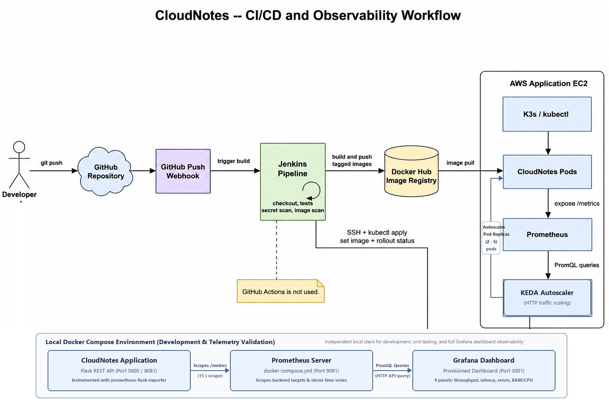

1. **Code Checkout**: Clones the latest code from `savinaysingh7/cloudnotes.git`.
2. **Backend Tests**: Builds a temporary Docker container (`cloudnotes-backend:test-${BUILD_NUMBER}`) and runs all **9 unit tests** using pytest (`test_health`, `test_create_note`, `test_create_note_missing_fields`, `test_get_notes`, `test_get_notes_search`, `test_update_note`, `test_update_nonexistent_note`, `test_delete_note`, `test_delete_nonexistent_note`). The pipeline halts immediately if any test fails.
3. **TruffleHog Secret Scan**: Downloads TruffleHog and scans the repository for verified credentials (`trufflehog filesystem . --only-verified --json > trufflehog.json`). The pipeline verifies the scanner exit status to halt immediately on unexpected execution errors, and inspects the captured findings file (`if [ -s trufflehog.json ]; then exit 1; fi`), failing the build if leaked secrets are detected.
4. **Build Docker Images**: Tags the tested backend image and builds the frontend Nginx image. Each image gets an immutable tag based on the Jenkins build number plus a `latest` tag.
5. **Trivy Vulnerability Scan**: Scans the backend Docker image for known high- and critical-severity vulnerabilities. The scan is non-blocking (`--exit-code 0`), so findings do not prevent image publication.
6. **Push to Docker Hub**: Authenticates using Jenkins credential injection (`dockerhub-credentials`) and pushes both images with their build-number and `latest` tags.
7. **Deploy to K3s**: Connects to the application server over SSH using a deploy key (`app-server-ssh-key`), applies the Kubernetes manifests, triggers a rolling image update (`kubectl set image deployment/backend ...`), waits for the rollout to complete (timeout: 180 seconds), and verifies the health endpoint.


# 6. Monitoring, Dashboards, and Alerting

## 6.1 Prometheus Metrics

I configured the Flask backend to expose metrics such as request count and response time. Prometheus collects these metrics every 15 seconds by scraping the `/metrics` endpoint.


The backend exposes these metrics through `prometheus-flask-exporter` and custom counters:
- **`flask_http_request_total`**: Counts HTTP requests, labeled by method, path, and status code.
- **`flask_http_request_duration_seconds`**: Records request latency as a histogram (useful for calculating percentiles like p95).
- **`notes_created_total`**: Counts how many notes have been created since the process started.
- **`notes_updated_total`**: Counts note updates.
- **`notes_deleted_total`**: Counts note deletions.

These custom counters are process-level counters. They reset when the backend pod restarts, so they do not represent the total count of notes in the database.

\newpage

## 6.2 Alert Rules

I defined four Prometheus alert rules in `monitoring/prometheus/alert_rules.yml`. The same rules are also embedded in `kubernetes/monitoring.yaml` for the Kubernetes deployment. The rules are evaluated every 15 seconds against incoming telemetry:

| Alert Name | What It Checks | When It Fires |
| --- | --- | --- |
| `BackendDown` | Whether the backend target is reachable (`up == 0`) | Backend is unreachable for 1 minute. Severity: critical. |
| `HighErrorRate` | Fraction of HTTP 5xx responses in the last 5 minutes | More than 10% of responses are server errors for 2 minutes. Severity: critical. |
| `HighRequestLatency` | 95th percentile of request duration over 5 minutes | p95 latency exceeds 1 second for 3 minutes. Severity: warning. |
| `NoNotesCreated` | Whether the `notes_created_total` counter has increased | No new notes for 1 hour (only fires if at least one note was previously created). Held for another hour. Severity: info. |

**Alert Evaluation Lifecycle and Routing**:
- **Evaluation Loop**: Prometheus evaluates all active alert expressions every 15 seconds according to its configured `evaluation_interval` (which matches the 15-second scrape interval).
- **State Progression**: Each alert rule transitions across three lifecycle states: `Inactive` (threshold normal), `Pending` (condition detected but within the configured `for` evaluation window), and `Firing` (condition persisted beyond the hold window). This staged transition prevents alert fatigue caused by momentary network latency or brief container restarts.
- **Severity Hierarchy**: I classified alerts by operational urgency: `critical` demands immediate operator intervention (service outage or catastrophic error spikes), `warning` signals degraded latency trends before user experience fails, and `info` provides operational traffic milestones.
- **Alertmanager Notification**: These rules are evaluated by Prometheus, but this course implementation does not deploy a separate Alertmanager notification daemon. In an enterprise environment, Alertmanager routes firing alerts to PagerDuty for on-call engineers, Slack channels for operations, and email lists for auditing.

\newpage

## 6.3 Grafana Dashboard

In the local Docker Compose environment, Grafana connects to Prometheus using a provisioned data source. The dashboard is loaded from `monitoring/grafana/provisioning/dashboards/cloudnotes.json` (UID: `cloudnotes-prod`, title: "CloudNotes Production Dashboard"). The Kubernetes deployment includes Prometheus but does not deploy Grafana.

The dashboard auto-refreshes every 5 seconds and shows the last hour of data. It has eight panels:

| Panel | Type | Metric | What It Shows |
| --- | --- | --- | --- |
| Backend Status | Stat | `up{job="cloudnotes-backend"}` | Green when the backend is up, red when it is down |
| Total Notes Created | Stat | `sum(notes_created_total)` | How many notes were created since the process started |
| Total Notes Deleted | Stat | `sum(notes_deleted_total)` | How many notes were deleted since the process started |
| Total Notes Updated | Stat | `sum(notes_updated_total)` | How many notes were updated since the process started |
| Error Rate (%) | Gauge | 5xx fraction over 5 minutes | Green (<1%), orange (1–5%), red (>5%) |
| HTTP Request Rate | Line chart | `rate(flask_http_request_total[5m])` | Request rate over time, grouped by method and status |
| P95 Latency | Line chart | 95th percentile of request duration | Tracks the slowest 5% of requests over time |
| Backend Memory | Line chart | `process_resident_memory_bytes` | Memory usage of the backend process |

The eight dashboard panels provide end-to-end visibility across service availability, throughput, error rates, p95 latency, and memory consumption. In testing, the dashboard reflected active traffic and verified that application metrics were continuously collected and visualized.

\newpage

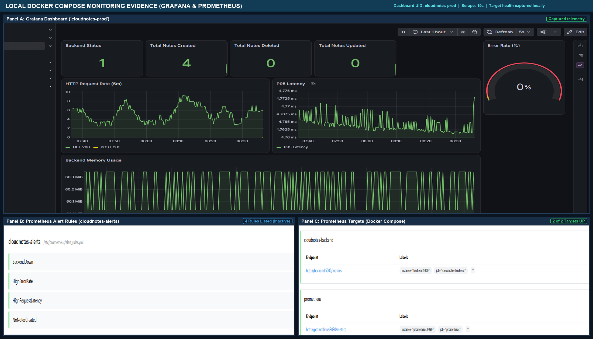

Figure 6.2 shows the monitoring stack in action during live testing:
- **Panel A (Grafana Dashboard)**: The dashboard confirms that the Flask backend is healthy (status: 1), 4 notes have been created, the error rate remains at 0%, and p95 request latency is under 5 ms. Process memory consumption is stable at approximately 60 MB during the recorded testing window.
- **Panel B (Prometheus Alert Rules)**: The `cloudnotes-alerts` rule group is actively loaded in Prometheus. All four defined alert rules (`BackendDown`, `HighErrorRate`, `HighRequestLatency`, and `NoNotesCreated`) are evaluated at the configured 15-second `evaluation_interval`, confirming rule parsing and metric binding.
- **Panel C (Prometheus Targets)**: Both scrape endpoints (`cloudnotes-backend` on port 5000 and `prometheus` internal metrics on port 9090) were in the `UP` state with zero scrape errors when this evidence was recorded. This confirms that telemetry was being collected successfully at the time the evidence was recorded.

\newpage

## 6.4 Kubernetes Monitoring and KEDA

In the Kubernetes cluster, Prometheus runs in the `cloudnotes` namespace (`kubernetes/monitoring.yaml`). A ConfigMap stores the 15-second scrape configuration and alert rules, a Deployment runs Prometheus v2.54.1, and an internal ClusterIP Service exposes it on port 9090. KEDA polls this instance to make horizontal autoscaling decisions (`kubernetes/hpa.yaml`):
```yaml
triggers:
- type: prometheus
  metadata:
    serverAddress: http://prometheus.cloudnotes.svc.cluster.local:9090
    metricName: backend_requests_per_second
    query: sum(rate(flask_http_request_total[1m]))
    threshold: '5'
```
When the aggregate request rate exceeds 5 requests per second, KEDA tells Kubernetes to add more backend pods (up to 5). When traffic subsides, pods are scaled back down to the minimum of 2 after a cooldown and stabilization period.

## 6.5 AWS CloudWatch Billing Monitoring

At the cloud infrastructure level, I configured a CloudWatch billing alarm through Terraform. The alarm evaluates the `EstimatedCharges` metric in `us-east-1` over 6-hour evaluation periods. When estimated spend reaches **$1 USD**, it publishes an alert to an SNS topic. Delivering email notifications requires an operator email subscription to be explicitly configured and confirmed on the topic. The alarm serves as an advisory monitor and does not automatically terminate running cloud resources.

\newpage

# 7. Security and Risk Assessment

## 7.1 Security Layers

I considered security at four levels: application code, containers, network access, and stored data:

- **Application & Code Security**: TruffleHog scans the checked-out repository during CI to detect verified leaked credentials. The pipeline checks the scanner exit status to catch unexpected tool failures and captures verified findings (`trufflehog filesystem . --only-verified --json > trufflehog.json`), halting execution if the report is non-empty (`if [ -s trufflehog.json ]; then exit 1; fi`) to prevent that build from proceeding to image publication. The Flask application uses SQLAlchemy ORM rather than raw SQL string concatenation; using SQLAlchemy ORM and parameterized queries helps reduce the risk of SQL injection. Endpoints validate incoming JSON payloads to ensure required fields are present before processing.
- **Container & Image Security**: Docker images are built from minimal base images (`python:3.11-slim` and `nginx:1.25-alpine`) to minimize the attack surface. In the Jenkins CI/CD pipeline, Trivy performs automated container vulnerability scans on the backend image only. It runs with `--exit-code 0`, meaning findings are logged for visibility but do not block the pipeline or prevent images from being pushed to Docker Hub. Build contexts are sanitized using `.dockerignore` files.
- **Network & Infrastructure Security**: CloudNotes provisions an isolated AWS VPC with defined CIDR ranges and security-group rules. At the AWS infrastructure level, security group rules allow inbound HTTP (port 80) and HTTPS (port 443) for web traffic, as well as administrative SSH (port 22) restricted to operator IPs. HTTPS/TLS is not configured for the current demonstration. PostgreSQL remains internal to the cluster. The backend is not exposed as a direct public service; external API requests are routed through the Nginx Ingress controller.
- **Operational & Secret Security**: Application credentials and database connection strings are decoupled from source code using environment variables (`.env`) and Kubernetes `Secret` resources (`postgres-secret.yaml`). Jenkins manages Docker Hub and EC2 SSH deployment keys using Jenkins Credentials Store and JCasC automation (`creds.groovy`). CloudWatch billing alarms actively monitor infrastructure spend by publishing alerts to an SNS topic when estimated charges reach $1 USD; receiving email notifications requires an operator email subscription to be explicitly configured and confirmed on the topic.

\newpage

## 7.2 Risk Assessment

| Area | What I Implemented | Known Limitation | Future Improvement |
| --- | --- | --- | --- |
| Secrets | TruffleHog CI scan, .env templates, Jenkins credential store, K8s Secrets | K8s Secrets are base64-encoded, not encrypted at rest | Integrate AWS Secrets Manager or HashiCorp Vault |
| Image Security | Trivy scans for HIGH/CRITICAL CVEs | Trivy runs non-blocking (--exit-code 0) to avoid breaking demos | Enforce blocking gates (--exit-code 1) for critical CVEs |
| Network | AWS VPC with security groups, internal K8s ClusterIP services | EC2 public IP exposure; traffic uses HTTP instead of HTTPS | Add TLS with cert-manager and Let's Encrypt; place EC2 behind ALB |
| Auth & Access | Presence checks for title and body in JSON requests | No user authentication or per-user access control | Implement OAuth2 / OpenID Connect with JWT bearer tokens |
| Availability | K8s Deployments with self-healing and rolling updates | Single-node K3s cluster in a single AWS Availability Zone | Migrate to multi-node Amazon EKS spanning multiple AZs |
| Data Backup | PersistentVolumeClaim on host storage; Docker volume pgdata | No automated snapshot lifecycle or point-in-time recovery | Migrate to Amazon RDS PostgreSQL with automated daily snapshots |
| Cost Control | CloudWatch billing alarm ($1 default), stop_mumbai.bat teardown | Alarm sends notification only; destroy requires operator confirmation | Configure AWS Budgets with Lambda to enforce automated spend caps |
| S3 Storage | Terraform-provisioned S3 bucket for static assets | Public access block is disabled for initial prototyping | Enable S3 Block Public Access and attach least-privilege IAM policies |
| Observability | Prometheus metrics, Grafana dashboard, KEDA autoscaler | Prometheus time-series data is stored ephemerally; no Alertmanager route | Add persistent storage via Thanos; connect Alertmanager to PagerDuty |


# 8. Live AWS Deployment and Verification

## 8.1 Deployment Setup

To test CloudNotes in a real cloud environment, I provisioned the infrastructure on AWS in the Mumbai (`ap-south-1`) region using Terraform. The deployment included:
- A VPC (`10.0.0.0/16`) with an Internet Gateway and public subnet (`10.0.1.0/24`).
- Security groups isolating the application server and the Jenkins server.
- A K3s cluster on Ubuntu 22.04 LTS, with Traefik disabled and Ingress-Nginx installed via Helm.
- A Jenkins server running the CI/CD pipeline.

To test the application without registering a public domain name, I mapped `cloudnotes.local` to the EC2 public IP address (`52.66.212.52`, a temporary demonstration address recorded during this deployment run) in the hosts file.

## 8.2 Frontend Verification

I opened the CloudNotes web interface at `http://cloudnotes.local/` in an automated Chromium session via Playwright.

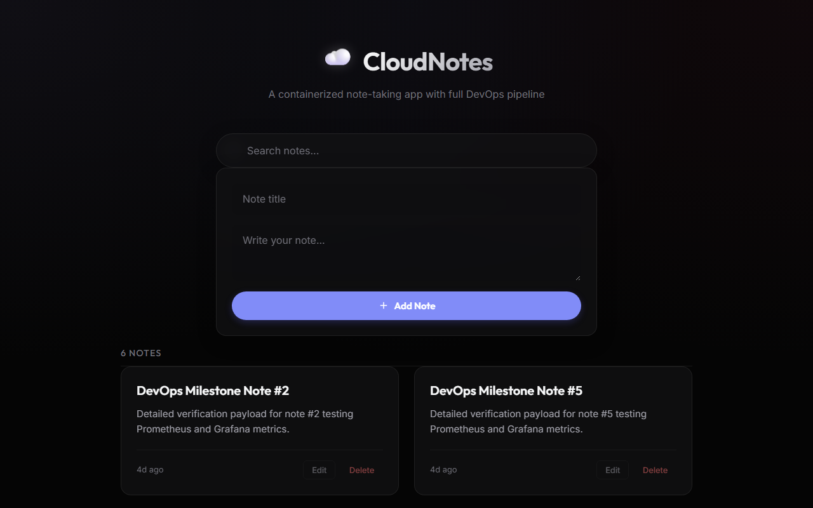

As shown in Figure 8.1:
- Nginx served the HTML, CSS, and JavaScript files correctly.
- The note creation form and notes grid rendered cleanly with one verified demonstration note.
- The frontend connected to the backend API.

\newpage

## 8.3 Note Creation and Persistence

I created a note through the web interface to test that data is saved correctly.

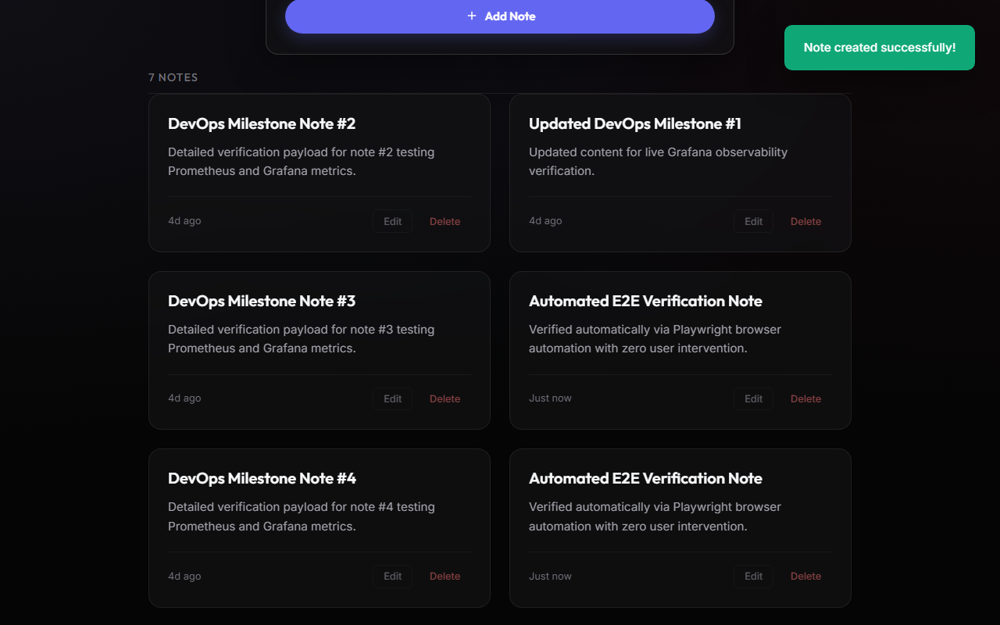

As shown in Figure 8.2:
- Submitting the form sent a `POST /api/notes` request with the title and body as JSON.
- The backend validated the input, saved the note to PostgreSQL, and incremented the `notes_created_total` Prometheus counter.
- The frontend displayed the second card as the newly created note (shown beside the initial note from Figure 8.1) and showed a green toast notification ("Note created successfully!").
- After refreshing the page, both notes remained displayed, confirming data persistence in PostgreSQL.

## 8.4 Health Check Verification

To confirm service health, I validated the `/api/health` probe endpoint.

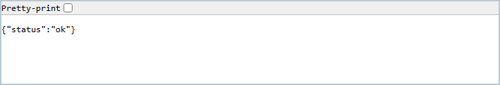

As shown in Figure 8.3:
- The endpoint returned HTTP 200 with `{"status":"ok"}`.
- In this implementation, `/api/health` functions as a service liveness check, confirming that the Flask WSGI process is running and accepting HTTP requests. It does not perform a live PostgreSQL database query. Adding a deep health probe that verifies database connectivity is documented as a future improvement.

\newpage

## 8.5 Jenkins Portal

I deployed and configured Jenkins with automated CI/CD pipeline orchestration (`http://13.127.44.70:8080/`, demonstration address recorded during deployment).

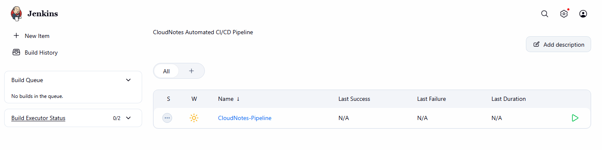

As shown in Figure 8.4:
- Jenkins was set up using Configuration as Code (`jenkins.yaml`) and Groovy initialization scripts (`creds.groovy`), automatically provisioning the `CloudNotes-Pipeline` job.
- The server managed pipeline credentials (`dockerhub-credentials`, `app-server-ssh-key`) and was configured to trigger builds on GitHub pushes.

## 8.6 Infrastructure Teardown

The `stop_mumbai.bat` script runs `terraform destroy -no-color`, which prompts the operator for confirmation before destroying the managed resources. After the command finishes, the script pauses so the result can be reviewed. I then checked the AWS Console for resources that Terraform might not have removed. Terraform destroyed all 14 managed AWS resources: 12 in Mumbai (`ap-south-1`) across EC2, security groups, subnet, route table, Internet Gateway, key pair, and S3, plus 2 CloudWatch/SNS billing alarm resources in `us-east-1`. Console verification confirmed that no residual resources remained.

## 8.7 Verification Summary

| What I Tested | How I Tested It | Result |
| --- | --- | --- |
| Frontend UI | Opened `http://cloudnotes.local/` via Playwright (Chromium) | Page loaded correctly with form and verified note |
| Note Creation | Submitted a note through the web form | Note saved to PostgreSQL; toast notification shown |
| Data Persistence | Refreshed the browser after creating a note | Note was still displayed from the database |
| Health Endpoint | Called `GET /api/health` | HTTP 200 with `{"status":"ok"}`; service liveness confirmed |
| Automated Tests | Ran pytest suite on backend | 9 unit tests passed across API routes and error cases |
| Jenkins | Opened Jenkins web UI on port 8080 | Server running with pipeline credentials configured |
| Infrastructure Teardown | Executed `stop_mumbai.bat` (`terraform destroy`) and checked AWS Console | All 14 managed resources destroyed; confirmed clean state in AWS Console |


\newpage

# 9. INT378 Course Outcomes Alignment

## 9.1 Mapping to Course Outcomes (CO1–CO6)

This project directly demonstrates the skills and knowledge described in the **INT378: Advancements in Cloud and DevOps** course outcomes:

| CO | Description | What I Built | How It Demonstrates the Outcome |
| --- | --- | --- | --- |
| CO1 | Cloud computing concepts, service models, security principles | AWS VPC, subnets, Internet Gateway, EC2, S3, security groups | Shows IaaS concepts: compute virtualization, cloud networking, and firewall configuration |
| CO2 | Scalability and elasticity in cloud solutions | K8s Deployments with multiple replicas; KEDA scales pods based on Prometheus metrics | Demonstrates the configuration of horizontal pod autoscaling using Prometheus traffic metrics. |
| CO3 | Network security and access control | VPC CIDR segmentation, security group rules, K8s ClusterIP, Ingress routing | Shows network isolation, SSH-based deployment, and host-based routing |
| CO4 | Cost optimization and cloud-native architecture | Containerized services, Terraform IaC, CloudWatch billing alarm, `terraform destroy` | Shows the create–use–destroy lifecycle for cost control |
| CO5 | Security practices in CI/CD | TruffleHog secret scanning, Trivy CVE scanning, Jenkins credential injection, health probes | Shows shift-left security integrated into the automated pipeline |
| CO6 | Emerging cloud technologies and governance | K3s Kubernetes, KEDA event-driven autoscaling, Prometheus/Grafana monitoring | Shows modern container orchestration and observability tools |

## 9.2 Practical Skills Demonstrated

The INT378 syllabus emphasizes hands-on tooling. CloudNotes provides working implementations for each area:
- **Containers**: Docker images replace traditional server installations.
- **Orchestration**: Kubernetes replaces manual process management with self-healing deployments and rolling updates.
- **Configuration as Code**: Jenkins settings are stored in `jenkins.yaml` instead of configured through the web UI.
- **Infrastructure Automation**: Terraform replaces manual AWS Console configuration with version-controlled, repeatable code.
- **Monitoring**: Prometheus and Grafana replace manual server inspection with real-time metrics and visual dashboards.


\newpage

# 10. Conclusion and Future Work

## 10.1 Summary

Through CloudNotes, I built and deployed a complete cloud application with an automated DevOps pipeline. The project combines a three-tier web application with Terraform infrastructure, Kubernetes orchestration, a Jenkins CI/CD pipeline, and Prometheus/Grafana monitoring.

I deployed the application infrastructure on AWS, verified that the frontend, backend, and database worked correctly, confirmed the health check on AWS, and validated the Prometheus/Grafana monitoring stack in the local Docker Compose environment. Afterward, I tore down all cloud resources using Terraform. The project demonstrates how modern DevOps practices—containers, infrastructure as code, automated testing, security scanning, and monitoring—work together in a real deployment.

## 10.2 Future Work

To move CloudNotes from a course project toward production use, these improvements would be needed:
1. **Managed Kubernetes (Amazon EKS)**: Replace single-node K3s with EKS spanning multiple Availability Zones for high availability.
2. **User Authentication**: Add login functionality using OAuth2 / OpenID Connect (for example, AWS Cognito or Keycloak) with per-user note ownership.
3. **HTTPS**: Deploy `cert-manager` with Let's Encrypt to encrypt all traffic.
4. **Managed Database**: Replace containerized PostgreSQL with Amazon RDS for automated backups and multi-AZ replication.
5. **Secrets Management**: Use AWS Secrets Manager or HashiCorp Vault instead of Kubernetes Secrets.
6. **Serverless Processing**: Add AWS Lambda functions triggered by S3 uploads or note creation events for tasks like text summarization.
7. **Ingress Modernization**: Replace the legacy `kubernetes.io/ingress.class: nginx` annotation with standard `spec.ingressClassName: nginx` in the Kubernetes Ingress manifest.

# References

1. **Project Repository**: *CloudNotes*, Savinay Singh. GitHub: [https://github.com/savinaysingh7/cloudnotes](https://github.com/savinaysingh7/cloudnotes)
2. **Course Curriculum**: *INT378: Advancements in Cloud and DevOps*, School of Computer Science and Engineering, Lovely Professional University, Academic Session 2026-2027.
3. **Docker Documentation**: *Docker Engine and Compose Specification*, Docker Inc., Available at: [https://docs.docker.com/](https://docs.docker.com/)
4. **Kubernetes Documentation**: *Production-Grade Container Orchestration*, The Linux Foundation / CNCF, Available at: [https://kubernetes.io/docs/](https://kubernetes.io/docs/)
5. **Terraform AWS Provider**: *HashiCorp Terraform Registry Documentation*, HashiCorp Inc., Available at: [https://registry.terraform.io/providers/hashicorp/aws/latest/docs](https://registry.terraform.io/providers/hashicorp/aws/latest/docs)
6. **Jenkins Documentation**: *Jenkins Pipeline and Configuration as Code User Handbook*, Jenkins Project, Available at: [https://www.jenkins.io/doc/](https://www.jenkins.io/doc/)
7. **Prometheus & Grafana**: *Time-Series Monitoring and Dashboard Visualization*, Prometheus Authors & Grafana Labs, Available at: [https://prometheus.io/docs/](https://prometheus.io/docs/) and [https://grafana.com/docs/](https://grafana.com/docs/)
8. **KEDA**: *Kubernetes Event-driven Autoscaling Documentation*, CNCF Graduated Project, Available at: [https://keda.sh/docs/](https://keda.sh/docs/)


# Appendix A. Repository Structure

| Directory / File | Description |
| --- | --- |
| `app/backend/` | Flask API, SQLAlchemy model, Gunicorn config, Dockerfile, and tests |
| `app/frontend/` | Web UI assets (HTML, CSS, JS), Nginx config, and Dockerfile |
| `docker/` | Docker Compose files, environment template, and recovery script |
| `kubernetes/` | Kubernetes manifests: deployments, services, ingress, storage, autoscaling |
| `terraform/` | Terraform root module, VPC/EC2/S3 submodules, and billing alarm |
| `jenkins/` | Jenkins Dockerfile, JCasC configuration, and initialization scripts |
| `monitoring/` | Prometheus scrape config, alert rules, and Grafana dashboard JSON |
| `diagrams/` | Architecture diagrams and rendered figures |
| `screenshots/` | Screenshots from the live AWS deployment |
| `scripts/` | PDF builder and utility scripts |
| `Jenkinsfile` | Jenkins pipeline definition (7 stages) |
| `start_mumbai.bat` / `stop_mumbai.bat` | Windows scripts to provision and destroy AWS infrastructure |
